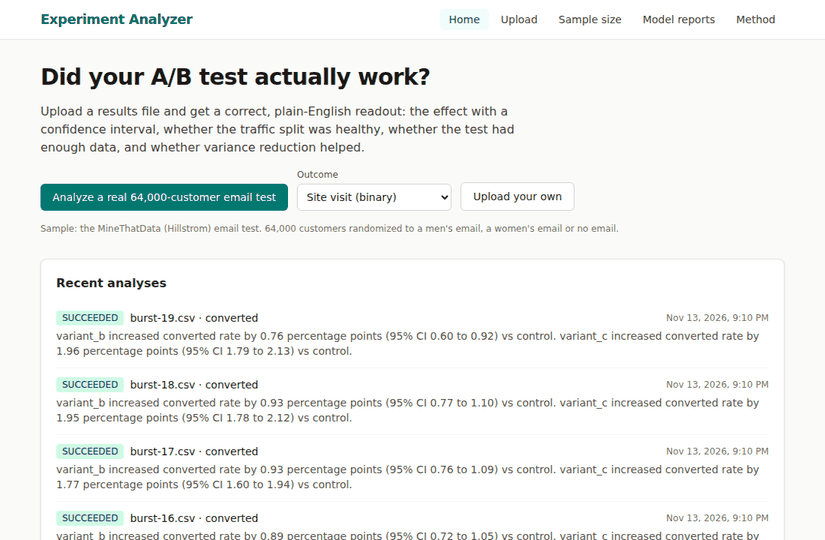
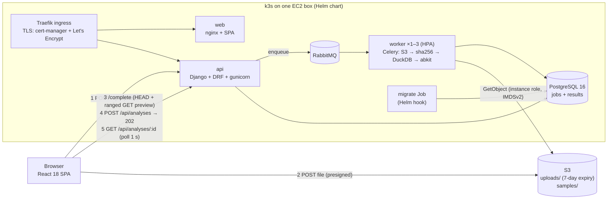

# Experiment Analyzer

Upload an A/B test results file, or click one button to use a real 64,000-customer email test, and get a correct,
plain-English readout: did the change win and by how much (95% CI), was the traffic split healthy (SRM), did the test
have enough data (power and MDE), and did variance reduction (CUPED) help.

[](https://github.com/aditya388182/experiment-analyzer/actions/workflows/ci.yml)
**Live:** not deployed yet. The AWS, DNS and GitHub steps are listed in order in [BLOCKERS.md](BLOCKERS.md) (Phase 7).



## The engineering problem

A statistics script becomes a service. Files go straight from the browser to S3 with a presigned POST, so the API
never carries the bytes. Analyses run as Celery jobs on RabbitMQ, so the API answers in milliseconds (202) and the UI
polls. Every result is keyed by sha256(file) + sha256(mapping), so the same file and mapping always return the same
stored result and a shared link is reproducible. The statistics live in their own package (`abkit`) and are checked
against SciPy and statsmodels and against the original lab results.

## Numbers (generated from `results/`; regenerate with `make readme`)

<!-- numbers:start -->
<!-- numbers:end -->

`make bullets` prints the resume bullets from the same files. A value that has not been measured yet prints `MISSING`.

## Architecture



| Piece | What it does |
|---|---|
| `abkit/` | Python stats package: Welch t, chi-square SRM, Holm, CUPED, MDE and sample size, `analyze()` and `verdict()` |
| `backend/` | Django 5.2 + DRF API, Celery task, DuckDB ingest, S3 access through boto3 |
| `frontend/` | React 18, Vite, TypeScript (strict), TanStack Query, React Hook Form + Zod, Recharts, Tailwind |
| `deploy/docker/` | multi-stage, non-root images (api and worker share one; web is nginx-unprivileged) |
| `deploy/compose.dev.yml` | the whole stack locally, with moto standing in for S3 |
| `deploy/helm/` | the chart: Deployments, StatefulSets with PVCs, Ingress, HPA, migrate hook, probes, limits |
| `.github/workflows/` | `ci.yml` (lint, all tests, integration, images, helm lint + kubeconform), `deploy.yml` |

Screenshots of every page: [docs/screenshots/](docs/screenshots/).

## Run it

Needs Docker, Make, [uv](https://docs.astral.sh/uv/) 0.13.1 and Node 24.22.3 (`.nvmrc`).

```bash
make dev            # postgres, rabbitmq, moto, migrate, api, worker, web: open http://localhost:8080
make test           # abkit + backend + frontend tests (backend needs `make infra-up` or `make dev`)
make test-integration   # real RabbitMQ + Celery worker + API, end to end
make lint           # ruff, eslint, tsc, helm lint, kubeconform
make k3d-up k3d-deploy k3d-smoke   # the Helm chart on a local k3s cluster (ingress on 127.0.0.1:8081)
make bullets        # resume bullets from results/
```

`make python` installs CPython 3.12.16 for uv (uv 0.13.1 cannot download it itself; see DECISIONS.md D1). All ports
are bound to 127.0.0.1. On a remote box, use `ssh -L 8080:127.0.0.1:8080 -L 5000:127.0.0.1:5000 <box>`.

## Testing approach

- **Equivalence:** every abkit function against an independent reference on 20 seeded datasets: Welch CI and p vs
  `scipy.stats.ttest_ind(equal_var=False)` (1e-9), SRM vs `scipy.stats.chisquare` (1e-12), Holm vs statsmodels
  `multipletests` (1e-12), CUPED theta vs the OLS slope and variance removed vs corr² (1e-9), MDE vs statsmodels
  `NormalIndPower` (1e-4 relative; statsmodels also counts the far tail; its `solve_power` root-finder stops early, so the
  test solves statsmodels' power curve to full precision: DECISIONS.md D5). Max differences go to `results/validation.json`.
- **Properties (Hypothesis):** the CI contains the estimate; swapping arms flips the sign and swaps the CI; Holm ≥ raw p
  and keeps the order; CUPED variance removed is in [0, 1]; MDE ↔ sample-size round trip; SRM flags 52/48 at n=100k and
  passes ≥ 99 of 100 true 50/50 splits.
- **Lab reproduction:** recompute the Hillstrom results from the CSV and compare to the lab's `results.json` (read
  from the file, never typed) to 1e-9: `results/lab_reproduction.json`.
- **Backend:** pytest-django against real Postgres. S3 is a moto server over HTTP, so presigned POSTs are real HTTP.
  Celery runs in eager mode for unit tests, and the integration test uses a real RabbitMQ and worker.
- **Frontend:** Vitest + React Testing Library + MSW; fixtures are real API responses, and a test checks their keys
  match the TypeScript types.

## Design decisions

1. **Presigned POST, not PUT.** A POST policy can enforce `content-length-range` (1 byte to 50 MB) and the exact key,
   so S3 itself rejects an oversize file. (moto does not enforce policies, so this is checked against real S3 in
   Phase 7: `make s3-policy-check`. The API also re-checks the HEAD size.)
2. **Background jobs.** A 50 MB file can take seconds. The API returns 202 at once and the UI polls every second until
   the job is terminal.
3. **Idempotency.** Key = sha256(file bytes) + sha256(canonical mapping JSON), plus the abkit version. A SUCCEEDED
   match is reused (`reused_from`), so no work is redone and a shared link is reproducible.
4. **Safe retries.** `acks_late=True` + `reject_on_worker_lost=True`: if a worker dies mid-job, the message is
   redelivered and the idempotent task recomputes it. Only transient S3/network errors are retried (3 times, 2/4/8 s).
   Bad data fails at once with a code. Soft time limit 120 s, hard 150 s.
5. **DuckDB in the worker.** It reads the CSV with every column declared VARCHAR and the sniffer off (a ragged row
   once fooled the sniffer into a wrong header), casts with `TRY_CAST`, counts dropped rows by reason, and hands
   numpy arrays per arm to abkit.
6. **Statistics in their own package.** `abkit` is versioned (0.1.0) and tested on its own. The app only calls it,
   and every analysis stores the abkit version and git commit that produced it.

More, with reasons: [DECISIONS.md](DECISIONS.md).

## Limits

- One metric per analysis; no Bayesian methods; no uplift models in the app (they stay in the lab).
- Normal-approximation intervals: fine at these sample sizes; arms under 30 rows get a warning.
- CUPED uses one pooled theta across arms; it is reported only when |corr| ≥ 0.1 and ≥ 5% of variance is removed.
- The worker autoscales on CPU; queue depth (KEDA) would be a better signal.
- Runs on one EC2 box (k3s); Postgres and RabbitMQ are single replicas with local-path volumes, so no high availability.
- Not yet verified against real AWS: the presigned POST policy (B1) and the instance-role path (B4). See BLOCKERS.md.
